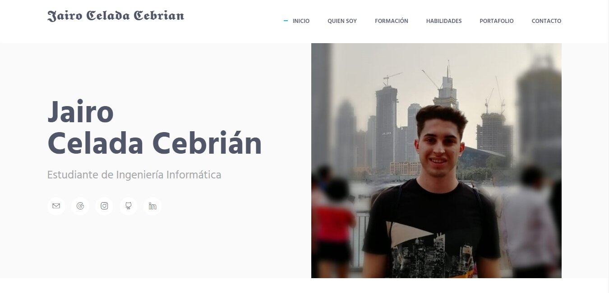

# Página Web creada por: Jairo Celada Cebrián

Página Web personal donde describo mis conocimientos, habilidades, formación e información sobre mí, también proporciono formas de contacto y adjunto mi Currículum.
💻<strong>Link a la web</strong>: https://Jairoxd98.github.io/ 
 

 
Las diferentes herramientas utilizadas para la creación de la página son las siguientes:

⚙️ HTML5

⚙️ CSS3

⚙️ JavaScript

⚙️ jQuery

⚙️ Bootstrap

⚙️ Github pages

 
He mejorado el posicionamiento SEO de mi página web mediante las siguientes herramientas:  

✅ Sitemap.xml: utilizado para listar todas las urls indexables de mi página web, con el objetivo de que los buscadores puedan encontrarlas de manera sencilla.

✅ Robots.txt: utilizado para evitar que ciertos bots que analizan los sitios web agreguen información innecesaria a los resultados de búsqueda.

✅ Google Analytics: utilizada para obtener información analítica relevante acerca de la web.

✅ Google Search Console: utilizada para comprobar el estado de la indexación de mi página en internet por el buscador y optimizar su visibilidad.

